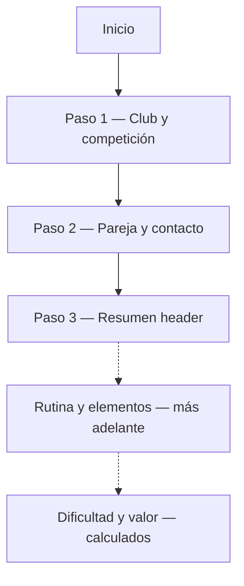

# UX & UI direction — Tariff Wizard

Companion to [CONTEXT.md](./CONTEXT.md). Describes **how** the coach moves through the app before we polish pixels.

---

## Design principles

1. **Mirror the sheet** — Wizard steps follow the paper/PDF (header on the right first, body later).
2. **One section per step** — Avoid one endless scroll mimicking the whole PDF at once.
3. **Coach-first Spanish** — Labels match federation wording where possible; English later via i18n.
4. **Calculated ≠ editable** — Difficulty and value are read-only when shown; never look like empty inputs.
5. **Forgiving validation** — Errors beside fields; optional country clearly marked.

---

## Wizard flow (pair v1)



### Paso 1 — Club y competición

Matches top part of right column (labels in **English** on the sheet — see [FIELD-LABELS.md](./FIELD-LABELS.md)):

- COUNTRY (opcional)
- CLUB
- PARTICIPATION NUMBER (opcional)
- COMPETITION
- LEVEL: first **system** (Base / Escolar / RFEG / FIG), then **age** (options depend on system)
- CATEGORY (options depend on system — see [LEVEL-AND-CATEGORY.md](./LEVEL-AND-CATEGORY.md))
- EXERCISE: Balance / Dynamic / Combined

### Paso 2 — Pareja y contacto

- GYMNASTS: **TOP** (1), **BASE** (1 para pareja)
- CONTACT PERSON: **NAME**, **TEL**

### Paso 3 — Resumen (header)

Read-only checklist of Paso 1 + 2 before continuing to routine work later.

> **Step 2 code note:** We may ship Paso 1+2 as a single coding step split across two UI steps, or one long step first — whichever is easier to learn. The **data model** stays one `header` object.

---

## Layout pattern (each step)

```text
┌─────────────────────────────────────┐
│  ← Inicio          Asistente        │
│  Paso 2 de 3 · Pareja y contacto    │
├─────────────────────────────────────┤
│  [ card: form fields ]              │
│  short hint: "Como en la columna    │
│  derecha de la hoja FIG"            │
├─────────────────────────────────────┤
│  [ Atrás ]              [ Siguiente ]│
└─────────────────────────────────────┘
```

- Max width ~`max-w-2xl` (already in `WizardShell`).
- Sticky footer navigation.
- Later: optional **preview strip** on wide screens showing “columna derecha” mock.

---

## Showing difficulty & value (future)

When calculations exist, show a **summary card** fixed to the logical “bottom of the right column”:

| Campo | UI |
|-------|-----|
| Dificultad | Read-only, tabular numerals |
| Valor | Read-only, tabular numerals |

Use `aria-readonly` and muted background — not disabled inputs (confusing).

---

## Tone (“El Mago”)

- Friendly **guide**, not a game character.
- One line of help per step max.
- Example: *“Estos datos van en la parte superior derecha de la hoja.”*

---

## Accessibility & gym environment

- Large tap targets on nav buttons.
- Works on 13″ laptop width.
- High contrast labels; errors linked with `aria-describedby`.

---

## Not in v1 UI

- Full element grid / FIG tables
- PDF export
- Login / multi-user
- Trio / group forms (schema ready; UI after pair works)
